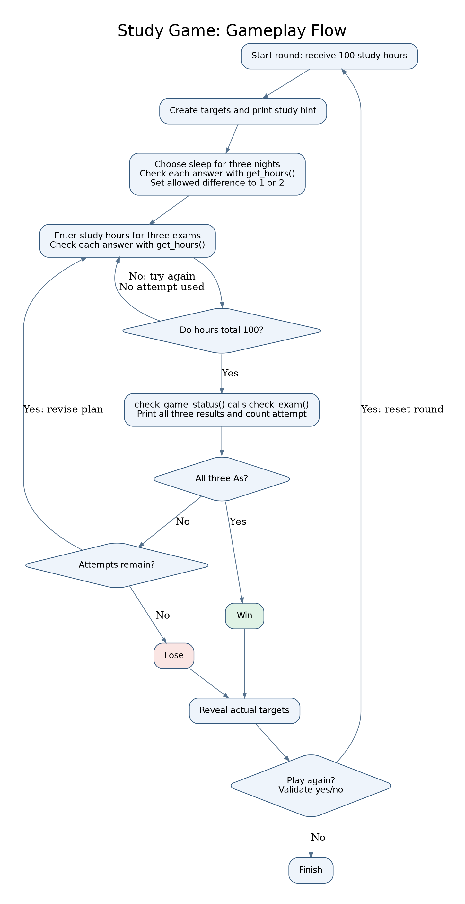

# Exam Study Game

## About the Game

This game is about planning study time for three college exams.
You have 100 hours to allocate to studying and must divide them across 3 exams.
Each exam has a random study target, must get an A on all three to win.

## How to run

Uses three files of code that include functions in order to play.
- Final_Project_Main.py
- study_functions.py
- User_Validation.py

Run Final_Project_Main.py to play the game

## How to Play

1. Read the hint about one randomly selected exam.
2. Choose your sleep hours for each of three nights.
3. Divide all 100 study hours among the three exams.
4. Read the feedback and adjust your plan if needed.
5. You have three attempts to earn three As.
6. Type yes to play again or no to stop.

Each night has a random sleep target from 6 to 9 hours.
Meeting at least two targets lets your study hours be within
2 hours of each exam target. Otherwise, you must be within 1 hour.

Sleep is separate from the 100 study hours. Invalid answers
do not use an attempt.

## Functions and Game Flow

- main(): runs the game and handles replaying.
- create_study_targets(): creates three targets totaling 100 hours.
- study_event(): gives a random exam hint.
- sleep_cycle(): checks sleep choices and returns the allowed difference.
- get_hours(): checks that input is a whole number within the limits.
- check_game_status(): calls check_exam() for all three exams.
- check_exam(): checks whether one exam earns an A.

## Tracking the Player

Study hours, exam targets, sleep totals, and attempts are
stored as integers because the game uses whole numbers.
The variables won and valid_hours are Booleans because they
represent True or False results.

check_game_status() returns True when all three exams earn As.
The targets stay the same during a round and reset on replay.

## Changes After Peer Review

My peers suggested adding functions, improving input checks,
and giving players information to help them make decisions.
Also, they recomended more random functions.

I split the code into three files, added input validation,
and included a random hint and three planning attempts.
I also added sleep choices that affect the acceptable study range.
This all helped the game be more playable and easier to beat.

I changed the study budget to 100 hours to remove the shortcut
of choosing only three total hours. I kept earning three As
as the win condition and overstudying as a game rule.
